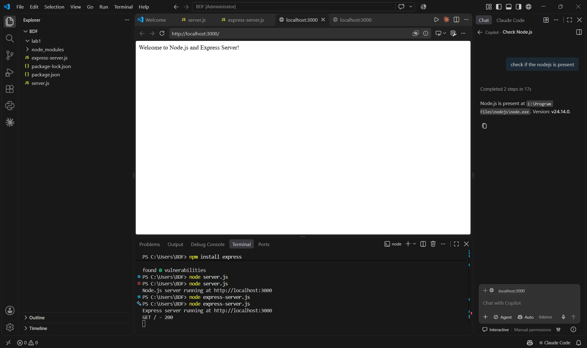
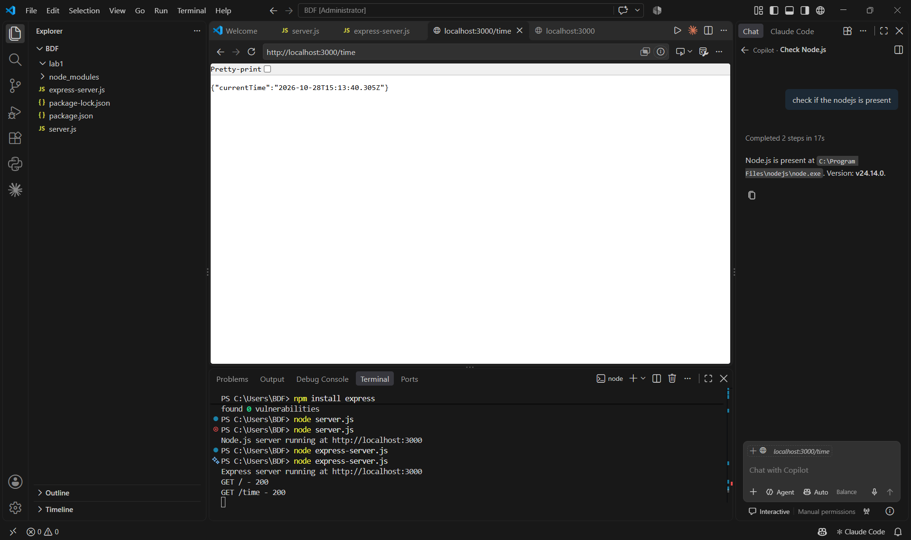
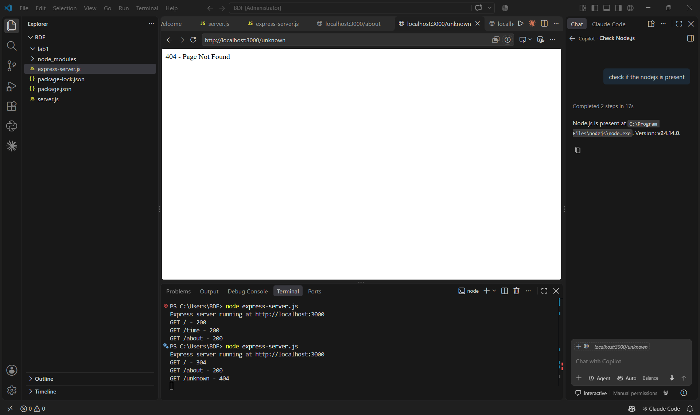

# BDF Lab 1 – Node.js and Express Server

**Deployment URL:**  https://vinuthnabdf.onrender.com
## Student Details

- **Name:** Bajjuri Vinuthna
- **Registration Number:** 252U1R5017
- **Section:** S-10
- **Course:** Backend Development Fundamentals
- **Lab:** Lab 1 – Node.js and Express Server

## Objective

To set up a Node.js project and build a small web server using the built-in HTTP module, then create a web server using Express.js.

## Project Description

This project demonstrates how to create a basic web server using Node.js and its built-in HTTP module and how to create a web server using Express.js.

The Express server provides three routes: `/`, `/about`, and `/time`. It also returns a 404 response for unknown routes.

## Technologies Used

- Node.js
- Express.js
- JavaScript
- npm

## Project Structure

BDF/
├── lab-1/
│   ├── http-server.js
│   ├── server.js
│   ├── package.json
│   ├── package-lock.json
│   ├── .gitignore
│   ├── README.md
│   └── screenshots/
│       ├── home.png
│       ├── about.png
│       ├── time.png
│       └── notfound.png
└── node_modules/  

## Explanation of package.json

The `package.json` file stores information about the Node.js project and its dependencies.

- **name:** Specifies the project name.
- **version:** Specifies the current project version.
- **description:** Provides a short description of the project, if present.
- **main:** Specifies the main entry file, if present.
- **scripts:** Defines commands that can be executed using npm.
- **author:** Specifies the project author, if present.
- **license:** Specifies the project's license, if present.
- **dependencies:** Lists packages required by the application, such as Express.js.
- **devDependencies:** Lists packages used during development, if present.

Only fields present in the actual `package.json` file apply to this project.

The `package-lock.json` file records the exact dependency versions used for installation. The `node_modules` folder contains the installed packages.

## Installation

### Prerequisites

- Node.js installed on the computer.
- npm, which is installed with Node.js.

### Steps

1. Clone the GitHub repository: 

   ```bash
   git clone  https://github.com/vinuthnabajjuri-25/vinuthnaBDF.git
   ```

2. Navigate to the Lab 1 folder:

   ```bash
   cd BDF/lab-01
   ```

3. Install the required dependencies:

   ```bash
   npm install
   ```

The `node_modules` folder is generated automatically when the dependencies are installed.

## Execution

### 1. Run the Basic HTTP Server

Run the following command:

```bash
node http-server.js
```

Open the following URL in your browser:

http://localhost:3000

The basic HTTP server should return the response configured in `http-server.js`. The Lab 1 task specifies a response of `Hello`.

Stop the server by pressing `Ctrl + C` before starting the Express server.

### 2. Run the Express Server

Run the following command:

```bash
node server.js
```

Open the following URL in your browser:

http://localhost:3000

The Express server should display the welcome message configured in `server.js`.

## API Endpoints

The following endpoints are provided by the Express server.

| Method | Endpoint | Description | Expected Status |
|---|---|---|---|
| GET | `/` | Returns a welcome message. | 200 OK |
| GET | `/about` | Returns JSON containing the student's name and section. | 200 OK |
| GET | `/time` | Returns the current date and time using `new Date()`. | 200 OK |
| GET | Any unknown path | Returns a Page Not Found message. | 404 Not Found |

## Deployment

The Express application is deployed using Render.

**Public Deployment URL:** https://vinuthnabdf.onrender.com
The deployed application can be opened in a web browser. The individual endpoints should also be tested using the public URL.

## Screenshots

The following screenshots demonstrate the endpoint responses.

### 1. Home Endpoint – GET /



### 2. About Endpoint – GET /about


### 3. Time Endpoint – GET /time



### 4. Unknown Route – 404 Response



## Testing

The endpoints should be tested by opening their URLs in a web browser.

The following checks should be performed:

1. Open `/` and check that the welcome message is displayed with status code 200.
2. Open `/about` and check that the student's name and section are returned as JSON with status code 200.
3. Open `/time` and check that the current date and time are displayed with status code 200.
4. Open an unknown route, such as `/unknown`, and check that the server returns status code 404.

The screenshots in the `screenshots/` folder provide evidence of the endpoint responses.

## Notes: Problems Faced and Solutions

1. **GitHub upload:** I learned how to stage, commit, and push the project files to GitHub using Git commands.
2. **Node modules:** I added `node_modules/` to `.gitignore` to prevent uploading installed dependencies to GitHub. Dependencies can be installed again using `npm install`.
3. **Deployment:** I configured the Node.js project for deployment on Render and obtained a public deployment URL.
4. **Testing:** I used a web browser to check the server responses and verify the expected endpoints.

## Important Notes

- Install dependencies using `npm install`.
- Do not upload the `node_modules/` folder to GitHub.
- Do not commit or share any `.env` file containing secrets.
- The basic HTTP server and Express server both use port 3000, so run them one at a time.
- Ensure all screenshot files exist in the `screenshots/` folder.
- Verify the endpoint responses and status codes before submission.
